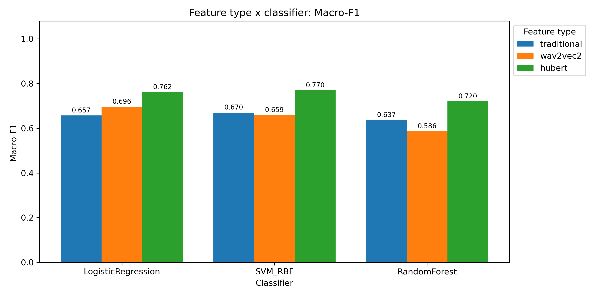

# RAVDESS Emotion: Acoustic and Self-Supervised Feature Baselines

本项目研究 RAVDESS 情绪语音的声学差异，并在相同的说话人独立划分下，比较传统声学特征、wav2vec 2.0 Base 和 HuBERT Base 表示的情绪分类能力。

核心流程：

1. 解析 RAVDESS 文件名，筛选 `neutral / happy / sad / angry` 四类情绪；
2. 使用 `librosa` 提取传统声学特征；
3. 可选使用 `parselmouth` 调用 Praat 提取 Jitter、Shimmer、HNR、Formant；
4. 对声学特征做单因素 ANOVA 与 FDR 校正；
5. 使用冻结的 wav2vec 2.0 Base、HuBERT Base，提取最后一层的 mean-pooled embedding，各 768 维；
6. 使用 Logistic Regression、SVM-RBF、Random Forest，在相同六折说话人划分下比较三套特征，共 9 种组合；
7. 输出统计检验、逐折指标、OOF 测试预测、混淆矩阵，以及特征类型 × 分类器的 Accuracy / Macro-F1 / AUC 对比表和图像。

当前已完成 672 条语音的三套特征比较。eGeMAPS 已预留训练输入接口，尚未提取或纳入现有结果。

## 1. 项目结构

```text
ravdess_emotion_baseline/
│
├── data/
│   ├── raw/
│   │   └── RAVDESS/
│   └── processed/
│       ├── ravdess_metadata.csv
│       ├── ravdess_acoustic_features.csv
│       ├── ravdess_wav2vec2_base_embeddings.csv
│       ├── ravdess_wav2vec2_base_embeddings.json
│       ├── ravdess_hubert_base_embeddings.csv
│       └── ravdess_hubert_base_embeddings.json
│
├── results/
│   ├── figures/                       # 原始声学分析图像
│   │   └── feature_comparison/         # 三套特征的对比图、表格图和混淆矩阵
│   └── tables/                        # 原始统计检验与分类结果
│       └── feature_comparison/         # 九种组合的分类结果和共享折号
│
├── src/
│   ├── 01_parse_metadata.py
│   ├── 02_extract_features.py
│   ├── 02_extract_ssl_embeddings.py
│   ├── 03_statistical_analysis.py
│   ├── 04_train_baseline_models.py
│   └── 05_visualize_results.py
│
├── tests/
│   ├── test_ssl_extraction.py
│   └── test_feature_comparison.py
├── requirements.txt                   # 传统分析与 SSL 提取的统一依赖
├── run_all_example.bat                # Windows 传统特征流程示例
├── run_all_example.sh                 # Bash 传统特征流程示例
└── README.md
```

## 2. 安装依赖

推荐使用 **Python 3.11 或 3.12（64 位）**；依赖列表统一放在 `requirements.txt`。
从项目根目录执行以下命令。Windows PowerShell 可先创建并激活虚拟环境：

```powershell
python -m venv .venv
.\.venv\Scripts\Activate.ps1
```

```bash
python -m pip install -r requirements.txt
```

依赖已包含 `praat-parselmouth`，但只有传入 `--use_praat` 才会提取 Jitter、Shimmer、HNR、Formant。
当前比较实验中的传统特征为默认 librosa 流程的 **124 维**，不含这些可选 Praat 特征。
SSL 提取需要 PyTorch 和 Transformers；直接读取已提取的 CSV 训练分类器时不加载这两个语音模型。

## 3. 准备数据

将 RAVDESS 的 Audio-only Speech `.wav` 文件解压到：

```text
data/raw/RAVDESS/
```

可以保留原始的 Actor_01、Actor_02 等文件夹结构，脚本会递归搜索 `.wav` 文件。
（由于 RAVDESS 原始音频文件较大，且数据集应由使用者从官方渠道获取，本仓库不包含原始 wav 文件。复现实验时，请将 RAVDESS Audio-only Speech 数据解压至 data/raw/RAVDESS/ 目录下。）

完整 Audio-only Speech 数据包含 24 位说话人、每人 60 条，共 1440 条音频。
本实验只保留四类情绪，每位说话人 28 条，共 **672 条**：

| 情绪 | 每位说话人 | 总样本数 |
|---|---:|---:|
| neutral（中性） | 4 | 96 |
| happy（开心） | 8 | 192 |
| sad（悲伤） | 8 | 192 |
| angry（生气） | 8 | 192 |
| 合计 | 28 | 672 |

`data/processed/ravdess_metadata.csv` 记录这 672 条样本，`file_path` 指向对应原始音频。
已有三套特征 CSV 时，可以直接运行 4.7 节的比较训练，无需重新下载模型或提取音频。
仓库提供的 embedding JSON 记录提取时的环境和来源路径，其中绝对路径用于追溯，不要求其他机器使用相同目录。

## 4. 运行流程

### 4.1 解析元数据

```bash
python src/01_parse_metadata.py \
  --raw_dir data/raw/RAVDESS \
  --out_csv data/processed/ravdess_metadata.csv
```

### 4.2 提取声学特征

基础版本，只使用 librosa：

```bash
python src/02_extract_features.py \
  --metadata_csv data/processed/ravdess_metadata.csv \
  --out_csv data/processed/ravdess_acoustic_features.csv
```

加入 Praat/Parselmouth 特征：

```bash
python src/02_extract_features.py \
  --metadata_csv data/processed/ravdess_metadata.csv \
  --out_csv data/processed/ravdess_acoustic_features.csv \
  --use_praat
```

### 4.3 统计分析

```bash
python src/03_statistical_analysis.py \
  --features_csv data/processed/ravdess_acoustic_features.csv \
  --out_dir results/tables
```

### 4.4 训练分类基线

四分类：neutral / happy / sad / angry。

```bash
python src/04_train_baseline_models.py \
  --features_csv data/processed/ravdess_acoustic_features.csv \
  --out_dir results/tables \
  --task four_class \
  --cv groupkfold \
  --n_splits 6
```

二分类：neutral vs negative，其中 negative = sad + angry。

```bash
python src/04_train_baseline_models.py \
  --features_csv data/processed/ravdess_acoustic_features.csv \
  --out_dir results/tables \
  --task neutral_vs_negative \
  --cv groupkfold \
  --n_splits 6
```

### 4.5 可视化结果

```bash
python src/05_visualize_results.py \
  --features_csv data/processed/ravdess_acoustic_features.csv \
  --anova_csv results/tables/anova_results.csv \
  --classification_csv results/tables/classification_results.csv \
  --predictions_csv results/tables/overall_predictions.csv \
  --fig_dir results/figures
```

### 4.6 提取自监督语音 embedding

新增 `src/02_extract_ssl_embeddings.py`，读取已有元数据中的 672 条 speech，
并与传统特征表逐行核对 `sample_id / file_name / actor / emotion`。
不重新扫描原始目录，避免把全部 1440 条音频误纳入实验。

默认使用两个冻结的预训练模型：

- wav2vec 2.0 Base：`facebook/wav2vec2-base`。
- HuBERT Base：`facebook/hubert-base-ls960`。

均使用 **最后一层 `last_hidden_state` 沿时间轴取均值**，每条语音得到 768 维向量。
采用 `eval()` 和 `inference_mode()`，不微调模型、不使用情绪标签学习表示。
逐条推理，无批次补零，因此池化均值不受 padding 帧影响。
音频预处理默认与传统脚本一致：16 kHz、单声道、`top_db=30` 首尾静音裁剪；
再由模型自己的 feature extractor 做逐条波形归一化。
这里的波形归一化不是跨样本的特征标准化；后续分类标准化仍应在训练折内部完成。

如尚未安装，先安装项目统一依赖（推荐 Python 3.11 / 3.12）：

```bash
python -m pip install -r requirements.txt
```

先校验样本及音频路径，再完整提取两个模型：

```bash
python src/02_extract_ssl_embeddings.py --validate_only
python src/02_extract_ssl_embeddings.py
```

首次提取需要联网下载模型。默认自动选择 CUDA（如可用），否则使用 CPU；
可以通过 `--device cpu` 或 `--device cuda` 指定设备。
模型缓存保存在项目的 `.cache/huggingface/`，已加入 Git 忽略列表。

小规模试运行（输出到单独目录，不用于完整实验）：

```bash
python src/02_extract_ssl_embeddings.py --limit 2 --out_dir results/ssl_smoke
```

可只运行一个模型，例如 `--models hubert`。离线使用 `--local_files_only`，
本地模型目录分别通过 `--wav2vec2_model`、`--hubert_model` 指定。
可用 `--wav2vec2_revision`、`--hubert_revision` 指定 Hugging Face commit hash 固定版本。
所有相对数据和输出路径均相对于项目根目录解释。

完整运行输出：

```text
data/processed/ravdess_wav2vec2_base_embeddings.csv
data/processed/ravdess_wav2vec2_base_embeddings.json
data/processed/ravdess_hubert_base_embeddings.csv
data/processed/ravdess_hubert_base_embeddings.json
```

每个 CSV 保留原始 17 个元数据列，并增加 768 个 embedding 列，样本顺序保持不变。
JSON 记录模型版本、预处理、软件版本、输入/输出 CSV 校验值和样本顺序。
提取失败会报错，不静默丢弃样本或填入伪造的 embedding。
已有 SSL 输出默认不会覆盖，需要显式 `--overwrite`。
提取脚本只生成 embedding 和提取记录；后续分类实验通过 4.7 节的训练命令运行。

模型及处理方式参考：
[wav2vec 2.0 Base](https://huggingface.co/facebook/wav2vec2-base)、
[HuBERT Base](https://huggingface.co/facebook/hubert-base-ls960)、
[Transformers Wav2Vec2 文档](https://huggingface.co/docs/transformers/en/model_doc/wav2vec2)。

### 4.7 特征类型 × 分类器对比实验

自监督 embedding 提取完毕后，运行：

```bash
python src/04_train_baseline_models.py --compare_features --task four_class --cv groupkfold --n_splits 6
python src/05_visualize_results.py
```

第一条命令同时训练 124 维传统声学特征、768 维 wav2vec 2.0 embedding、
768 维 HuBERT embedding，每套特征均使用相同的 LR、SVM-RBF、RF，共 9 种组合。
SSL 表示作为固定输入，训练的是这三个分类器，不微调 wav2vec 2.0 / HuBERT。

训练前先按 `sample_id` 对齐各表，并验证文件名、说话人、情绪标签一致，
拒绝缺失、重复或标签冲突的样本。所有组合共享一组 CV 索引。
六折比较模式默认从原有 `results/tables/fold_metrics.csv` 复用测试说话人列表，
保证与已保存的原实验划分完全相同，避免不同 NumPy/sklearn 版本的并列分组排序变化。
可以用 `--fold_protocol_csv` 指定另一份已有的 `fold_metrics.csv`。
没有旧协议文件时才重新生成 GroupKFold；其他折数和 LOGO 使用相应的划分方式。

分类器参数保持原实验设置：LR `max_iter=5000`；SVM-RBF `C=10, gamma=scale`；
RF 500 棵树；均 `class_weight=balanced, random_state=42`。
中位数填补在训练折内部完成；LR/SVM 的 StandardScaler 也只在训练折内部拟合。
RF 沿用原流程，不额外标准化。

现有六折协议中，每折训练 20 位说话人的 560 条音频，测试另外 4 位说话人的 112 条音频：

| 折号 | 测试说话人 Actor |
|---|---|
| 1 | 6, 12, 18, 24 |
| 2 | 5, 11, 17, 23 |
| 3 | 4, 10, 16, 22 |
| 4 | 3, 9, 15, 21 |
| 5 | 2, 8, 14, 20 |
| 6 | 1, 7, 13, 19 |

比较实验单独保存到 `results/tables/feature_comparison/`：

```text
classification_results.csv            # 9 个组合的汇总 OOF 指标和混淆矩阵
fold_metrics.csv                      # 9 × 6 = 54 行逐折指标
overall_predictions.csv               # 9 × 672 = 6048 行测试预测和概率，附特征类型、折号
cv_assignments.csv                    # 每条样本的共享测试折号
feature_classifier_comparison.csv     # 长表：特征类型、分类器、维数、Accuracy、Macro-F1、AUC
feature_classifier_comparison_wide.csv # 宽表：特征类型 ×（分类器 × 指标）
```

后两个表由可视化脚本输出。Accuracy、Macro-F1、AUC 均基于合并所有折的 OOF
测试预测计算，和原项目汇总指标口径一致；多分类 AUC 使用 macro one-vs-rest，
不将各折 AUC 的均值当作汇总 AUC。

可视化脚本保留原实验图像，同时读取比较实验结果，输出到
`results/figures/feature_comparison/`：对比表 PNG、三个指标的分组柱状图、9 张混淆矩阵。
混淆矩阵按特征类型和分类器分别生成，避免混合预测或文件覆盖。
只绘制比较实验结果可以运行以下单行命令：

```bash
python src/05_visualize_results.py --classification_csv results/tables/feature_comparison/classification_results.csv --predictions_csv results/tables/feature_comparison/overall_predictions.csv --fig_dir results/figures/feature_comparison --skip_boxplots
```

也可选择单套特征，例如 `--feature_sets hubert`，或用 `--feature_sets traditional hubert`
选择一部分组合。原有不带这些选项的训练命令仍只运行传统特征。

如果后续已有 eGeMAPS Functionals 特征表（88 维数值特征，带
`sample_id / file_name / actor / emotion` 对齐列，不应包含其他数值型辅助字段），
可用 `--feature_sets traditional wav2vec2 hubert egemaps --egemaps_csv <路径>` 纳入同一实验。
当前代码不提取 eGeMAPS，也不会在该文件缺失时生成它的实验结果。

### 4.8 当前实验结果

以下为当前四分类、六折说话人独立协议的汇总 OOF 测试指标，来自
[`feature_classifier_comparison.csv`](results/tables/feature_comparison/feature_classifier_comparison.csv)。
Accuracy 用百分比显示，Macro-F1 和 AUC 取四位小数。

| 特征类型 | 维数 | 分类器 | Accuracy | Macro-F1 | AUC |
|---|---:|---|---:|---:|---:|
| 传统声学特征 | 124 | LR | 68.15% | 0.6570 | 0.8804 |
| 传统声学特征 | 124 | SVM-RBF | 70.39% | 0.6702 | 0.8992 |
| 传统声学特征 | 124 | RF | 67.86% | 0.6366 | 0.8843 |
| wav2vec 2.0 Base | 768 | LR | 70.54% | 0.6961 | 0.8924 |
| wav2vec 2.0 Base | 768 | SVM-RBF | 67.71% | 0.6590 | 0.8856 |
| wav2vec 2.0 Base | 768 | RF | 62.65% | 0.5865 | 0.8635 |
| HuBERT Base | 768 | LR | 76.79% | 0.7620 | 0.9380 |
| **HuBERT Base** | **768** | **SVM-RBF** | **77.68%** | **0.7700** | **0.9422** |
| HuBERT Base | 768 | RF | 73.21% | 0.7202 | 0.9094 |

本次实验中 HuBERT + SVM-RBF 的三个指标均为最高；相比传统特征 + SVM-RBF，
Accuracy 提高约 7.29 个百分点。结果针对本项目的样本、模型参数和六折协议，
尚未进行超参数搜索、模型微调或分类性能差异的显著性检验。



[查看完整表格图片](results/figures/feature_comparison/feature_classifier_comparison.png)
 · [查看宽表 CSV](results/tables/feature_comparison/feature_classifier_comparison_wide.csv)

### 4.9 验证代码

```bash
python -m unittest discover -s tests -v
```

测试覆盖样本标识对齐、缺失/重复样本拒绝、原有说话人折协议复用、说话人隔离、
OOF 折号一致性、AUC 计算、对比表和混淆矩阵文件隔离。
mean pooling 的真实张量测试需要 PyTorch；未安装时会明确跳过。
测试不下载模型，也不重复执行完整的 54 次分类器训练。

## 5. 主要输出文件

```text
data/processed/ravdess_metadata.csv
data/processed/ravdess_acoustic_features.csv
data/processed/ravdess_wav2vec2_base_embeddings.csv
data/processed/ravdess_wav2vec2_base_embeddings.json
data/processed/ravdess_hubert_base_embeddings.csv
data/processed/ravdess_hubert_base_embeddings.json
results/tables/anova_results.csv
results/tables/tukey_results.csv
results/tables/fold_metrics.csv
results/tables/classification_results.csv
results/tables/overall_predictions.csv
results/figures/*.png
results/tables/feature_comparison/*.csv
results/figures/feature_comparison/*.png
```

## 6. 注意事项

1. RAVDESS 的 neutral 样本数量少于 happy/sad/angry，因为 neutral 没有 strong intensity 条件。
2. 分类实验必须使用说话人独立划分，不能随机划分音频样本。
3. 标准化、缺失值填补必须放在交叉验证内部，本项目已通过 sklearn Pipeline 实现。
4. Jitter、Shimmer、HNR、Formant 可能因为个别音频条件提取失败，失败值会记录为 NaN，后续由中位数填补。
5. 第一版建议先不加 `--use_praat`，等 librosa 流程跑通后再补充音质特征。
6. `run_all_example.bat` / `.sh` 只训练传统特征；要比较自监督表示，请运行 4.6、4.7 节命令。
7. 不同任务应使用不同的 `--out_dir`，避免四分类、二分类结果相互覆盖；对应可视化输入也需显式指定。
8. 声学差异分析使用普通单因素 ANOVA，尚未控制同一说话人的重复样本、性别和情绪强度，结论应按探索性分析理解。
